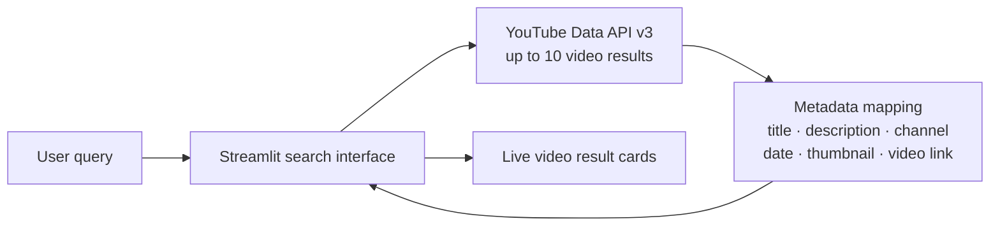
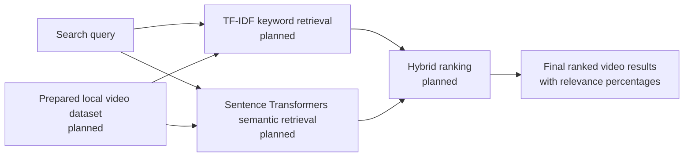

<div align="center">

<h1>LearnSeek</h1>

<h3>AI-Powered Educational Video Search System</h3>

<p><strong>Discover. Learn. Understand.</strong></p>

<p>Find educational videos that match what you want to learn.</p>

<p>LearnSeek is an Information Retrieval project that searches YouTube for learning videos and presents the results in a clean Streamlit interface. The current version supports live YouTube search; hybrid retrieval and local search are planned next steps.</p>

<p>
  <a href="https://github.com/AadiVicky547/LearnSeek-Educational-Video-Search-System"></a>
  
  
  
</p>

</div>

---

## Overview

Finding a useful lesson can take more than entering a few keywords. A video may explain the right idea using different words, and ordinary keyword matching can miss that connection. Information Retrieval (IR) techniques can compare both the words in a query and its meaning to help bring relevant learning material forward.

LearnSeek is being developed around that idea. **Today**, it sends a search query to YouTube Data API v3 and displays real matching video metadata. **The planned IR phase** will add keyword and semantic retrieval over a prepared local collection.

## Features and project status

| Capability | Status | What it means today |
| --- | --- | --- |
| Live educational-video discovery | **Implemented** | Search YouTube with a user query and show up to 10 returned videos. Results reflect YouTube relevance. |
| YouTube Data API v3 integration | **Implemented** | Uses a locally configured API key; handles missing-key, quota, network, and API errors with safe messages. |
| Video metadata display | **Implemented** | Captures title, description, video ID, YouTube URL, channel, publication date, and thumbnail when available. Result cards show the title, description, channel, date, thumbnail, link, and the search query as a topic label. |
| Streamlit search interface | **Implemented** | Provides a search form, sample topics, result cards, thumbnails, and links to the original videos. |
| Offline automated checks | **Implemented** | Unit tests check metadata mapping, request limits, and safe error handling without making live API calls. |
| Local dataset of 200 videos in 9 subjects | **Planned** | No collection has been added yet. |
| Local search when the API is unavailable | **Planned** | The current application reports an API error; it does not fall back to a local dataset. |
| Identical-query cache for 10 minutes | **Planned** | Searches currently make a fresh API request. |
| TF-IDF keyword retrieval | **Planned** | The dependency is listed, but the retrieval algorithm is not implemented. |
| Sentence Transformers semantic retrieval | **Planned** | The dependency is listed, but embeddings and semantic search are not implemented. |
| Hybrid ranking and relevance percentages | **Planned** | Search results currently follow YouTube relevance; LearnSeek does not calculate its own relevance score yet. |

> **Status note:** A package appearing in `requirements.txt` does not mean its planned feature is already active in the application.

## How it works

### Current pipeline



The application displays results returned by YouTube. It does not currently search the planned local dataset or calculate a LearnSeek relevance percentage.

### Planned hybrid retrieval pipeline



The future ranker is intended to combine keyword overlap with semantic similarity and show a single final relevance value per result. The design is described in [PROJECT_DOCUMENTATION.md](PROJECT_DOCUMENTATION.md); it is not implemented yet.

## Technology

| Technology | Role | Current use |
| --- | --- | --- |
|  | Application language | **Used** |
|  | Web interface | **Used** |
|  | Live video search and metadata | **Used** |
|  | Load the local API key from `.env` | **Used** |
|  | Dataset preparation | Listed for planned data work |
|  | Numerical operations | Listed for planned retrieval work |
|  | TF-IDF keyword retrieval | Listed; algorithm not implemented |
|  | Semantic retrieval | Listed; model not loaded |
|  | Text preprocessing | Listed for planned preprocessing |

Dependencies and compatible version ranges are listed in [`requirements.txt`](requirements.txt).

## Application preview

There are no application screenshots in the repository yet. To add a real preview later, save a screenshot as `assets/learnseek-preview.png` and replace this note with:

```markdown

```

No placeholder or generated screenshot is presented as an image of the running application.

## Project structure

```text
LearnSeek-Educational-Video-Search-System/
├── .env.example                 # Safe template for the local YouTube API key
├── .gitignore                   # Excludes secrets, virtual environments, and local artifacts
├── DATASET_INFO.md              # Planned dataset fields, categories, and quality guidance
├── PROJECT_DOCUMENTATION.md     # Proposed architecture and retrieval methodology
├── README.md                    # Project guide
├── requirements.txt             # Current and planned Python dependencies
├── assets/                      # Empty; reserved for screenshots and other assets
├── dataset/                     # Empty; no videos have been collected yet
├── models/                      # Empty; no model files or retrieval indexes yet
├── src/
│   ├── __init__.py              # Makes src importable as a Python package
│   ├── app.py                   # Streamlit UI and result rendering
│   ├── presentation.py          # Result formatting and theme stylesheet helpers
│   └── youtube_service.py       # YouTube API search, metadata mapping, and safe errors
└── tests/
    ├── test_app.py              # Offline checks for the Streamlit entry point
    ├── test_presentation.py     # Tests for result formatting helpers
    └── test_youtube_service.py  # Mocked API mapping and error-handling tests
```

The real `.env` file and `.venv/` are local machine files and are intentionally not part of the project tree. The data, assets, and models folders are currently empty; Git does not store empty directories.

## Installation and setup

### 1. Clone the repository

```bash
git clone https://github.com/AadiVicky547/LearnSeek-Educational-Video-Search-System.git
cd LearnSeek-Educational-Video-Search-System
```

### 2. Create and activate a virtual environment

**Windows PowerShell**

```powershell
py -m venv .venv
.\.venv\Scripts\Activate.ps1
```

**macOS / Linux**

```bash
python3 -m venv .venv
source .venv/bin/activate
```

### 3. Install dependencies

```bash
python -m pip install -r requirements.txt
```

### 4. Configure the YouTube API key

Copy the example file to a private `.env` file in the project root, then replace its placeholder with your own YouTube Data API v3 key. Do not commit or share `.env`.

**Windows PowerShell**

```powershell
Copy-Item .env.example .env
notepad .env
```

**macOS / Linux**

```bash
cp .env.example .env
```

Edit `.env` locally so it contains this setting, with your own key as the value:

```dotenv
YOUTUBE_API_KEY=your_key_goes_here
```

Never paste a real key into this README, a terminal command, or a public commit. The application loads the setting with `python-dotenv`.

### 5. Run LearnSeek

From the project root, with the virtual environment active:

```bash
streamlit run src/app.py
```

On Windows, you can also run it without activating the environment first:

```powershell
.\.venv\Scripts\python.exe -m streamlit run src/app.py
```

## Usage

1. Start the app and open the local address printed by Streamlit.
2. Enter a subject or learning question, such as `computer networks` or `how do seasons change?`.
3. Select **Search videos**. LearnSeek requests up to 10 videos from YouTube Data API v3.
4. Review the returned thumbnail, title, channel, date, and description.
5. Select **Watch on YouTube** to open the original video.

Search requires an available network connection and a valid API key. YouTube API quota limits may affect live searches. The current version does not provide local search when the API is unavailable.

## Testing

Tests use mocked API responses and do not need a valid YouTube key or make YouTube requests. From the project root, run:

```bash
python -m unittest discover -s tests -v
```

On Windows, if the environment is not activated:

```powershell
.\.venv\Scripts\python.exe -m unittest discover -s tests -v
```

## Roadmap

- [x] Establish the project structure and design documentation.
- [x] Build a Streamlit search page connected to YouTube Data API v3.
- [x] Map available video metadata and display real live search results.
- [x] Add safe handling for missing keys, API quota errors, and network failures.
- [x] Add offline automated tests for the current search and presentation code.
- [ ] Collect and validate 200 educational videos across 9 subject categories.
- [ ] Add local dataset loading and search when the API is unavailable.
- [ ] Cache identical live queries for 10 minutes.
- [ ] Implement TF-IDF keyword retrieval and Sentence Transformers semantic retrieval.
- [ ] Combine retrieval signals into a hybrid ranking with relevance percentages.
- [ ] Evaluate retrieval quality with representative queries and documented relevance judgments.

## Contributing

Contributions are welcome. Before opening a pull request:

1. Open an issue for a larger change so the approach can be discussed.
2. Keep API keys and `.env` files out of commits.
3. Keep planned functionality clearly identified until it is implemented.
4. Run the automated tests and describe the change and its verification.

## License

No license has been added to this repository yet. Until one is selected, reuse and redistribution permissions are not defined.

## Credits

LearnSeek is an educational Information Retrieval project. Creator name and contact details have not been provided in the repository.

---

<div align="center">

<p><strong>LearnSeek · Discover. Learn. Understand.</strong></p>

</div>
